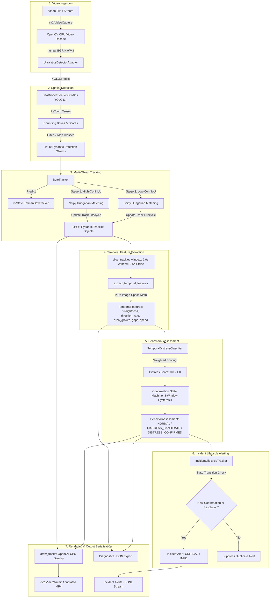
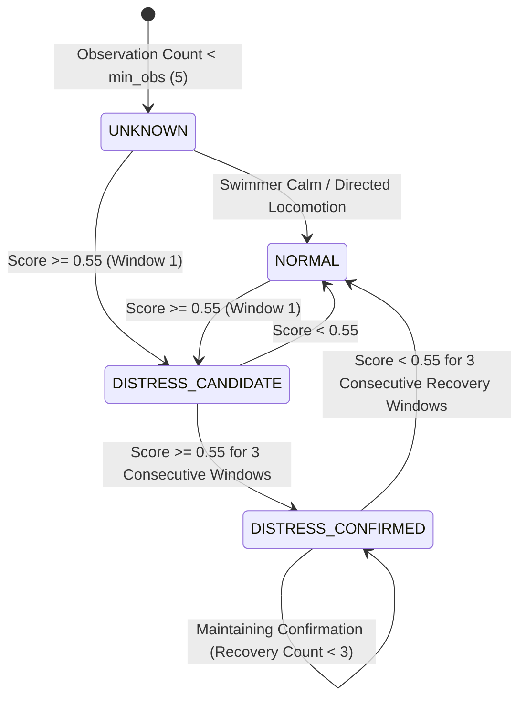

# DFR-CV — Comprehensive Computer Vision System Audit

**Document:** `DFR_CV_COMPREHENSIVE_AUDIT.md`  
**Date:** November 6, 2026  
**Auditor Roles:** Senior Computer Vision Architect, ML Systems Engineer, Edge AI Engineer  
**Target Repository:** `dfr-cv` (Autonomous Aerial Incident Perception System)  
**Target Deployment Target:** NVIDIA Jetson Orin Nano (40W / 15W / 7W embedded platform)  
**Audit Scope & Methodology:** Strictly Read-Only Investigation. Zero modifications to source code, dependencies, checkpoints, or tracked git state.

---

## 1. Executive Summary

This comprehensive technical audit assesses the current engineering condition, architectural maturity, algorithmic fidelity, data integrity, and edge-readiness of the `dfr-cv` autonomous aerial search-and-rescue (SAR) drone perception module.

### Core Audit Verdict
The project presents a **sharp dichotomy between core architectural discipline and production perception reality**:
1. **Strengths:** The core software engineering under [`src/schemas/`](file:///Users/pawaneswaran/Desktop/Work/PROJECTS/drone-cv/dfr-cv/src/schemas) and [`src/domain/`](file:///Users/pawaneswaran/Desktop/Work/PROJECTS/drone-cv/dfr-cv/src/domain) is well structured. Data contracts are strictly typed using Pydantic V2 (`frozen=True`, `extra="forbid"`), domain ontologies are decoupled from model framework indices, and the sequential video tracking pipeline ([`src/pipeline/track_video.py`](file:///Users/pawaneswaran/Desktop/Work/PROJECTS/drone-cv/dfr-cv/src/pipeline/track_video.py)) cleanly bridges detection, multi-object tracking (ByteTrack), temporal kinematic extraction, and behavioral distress alerting. 109 unit tests pass.
2. **Critical Vulnerabilities & Blockers:**
   - **Perception Scale Dilemma:** The active maritime detector ([`models/seadronessee-yolov8n.pt`](file:///Users/pawaneswaran/Desktop/Work/PROJECTS/drone-cv/dfr-cv/models/seadronessee-yolov8n.pt)) was trained exclusively on high-altitude aerial imagery (swimmers $\sim 10\text{--}80\text{ px}$). On medium- and close-range video footage, it suffers catastrophic receptive-field breakdown: formal ground-truth recall at default resolution drops to **$2.13\%\text{--}4.96\%$**, the swimmer's torso is misclassified as `watercraft` (163 false alarms across 90.1% of frames in `swimming2.mp4`), and target boxes fragment into legs and torso.
   - **Non-Existent Training Infrastructure:** There is **no executable training or fine-tuning pipeline** for maritime search-and-rescue. The repository's lone training script ([`src/train.py`](file:///Users/pawaneswaran/Desktop/Work/PROJECTS/drone-cv/dfr-cv/src/train.py)) trains a YOLO model on the urban vehicle benchmark `VisDrone.yaml` on `device='0'`. The `configs/` directory is completely empty. Checkpoints cannot be reproduced from local files.
   - **Absence of Real Labeled Datasets:** The repository contains **zero ground-truth training or validation annotation files** in standard formats (COCO, YOLO, MOTChallenge). The total video footage in the repository spans approximately 38 seconds across 10 files (6 of which are identical 141-frame clips), including synthetic CGI renders (`swimming2.mp4`). The sole "ground truth" used in recent reports was synthesized algorithmically via an ad-hoc skin-color heuristic (`r > b + 20 & r > 70`).
   - **Image-Space Ego-Motion Conflation:** The tracker ([`src/tracking/byte_tracker.py`](file:///Users/pawaneswaran/Desktop/Work/PROJECTS/drone-cv/dfr-cv/src/tracking/byte_tracker.py)) and temporal kinematics engine ([`src/analysis/temporal_features.py`](file:///Users/pawaneswaran/Desktop/Work/PROJECTS/drone-cv/dfr-cv/src/analysis/temporal_features.py)) calculate motion entirely in 2D image pixel space without Camera Motion Compensation (CMC) or drone telemetry integration. UAV translation, gimbal pitch, and wind drift directly contaminate swimmer velocity, straightness, and direction-change rates, causing spurious distress alarms or missed tracks.
   - **Edge Deployment Chasm:** The current software stack cannot run on NVIDIA Jetson Orin Nano in real time without major modifications. TensorRT and ONNX runtime are not integrated; dependencies (`scipy`) are unpinned in [`requirements.txt`](file:///Users/pawaneswaran/Desktop/Work/PROJECTS/drone-cv/dfr-cv/requirements.txt); Python 3.13 is incompatible with standard JetPack Linux; and massive CPU-GPU synchronization bottlenecks exist (per-frame decoding on CPU, host-to-device transfers, GPU inference, device-to-host tensor copy, Python loops instantiating hundreds of Pydantic objects, CPU Hungarian matching, and CPU OpenCV rendering).
   - **Documentation vs Code Divergence:** The [`README.md`](file:///Users/pawaneswaran/Desktop/Work/PROJECTS/drone-cv/dfr-cv/README.md) describes the project as having completed only Milestone 1 (data contracts) with all ML and tracking "Pending", completely ignoring Milestones 2 through 6.1 implemented in source code and detailed in internal reports. Conversely, legacy dead code in [`src/use_cases/`](file:///Users/pawaneswaran/Desktop/Work/PROJECTS/drone-cv/dfr-cv/src/use_cases) (fire detection, ALPR, crowd density) remains checked in with dummy mock tests.

---

## 2. Repository and Git Snapshot

### Git Working Tree Status
- **Current Branch:** `working` (tracks `origin/working`).
- **HEAD Commit SHA:** `e55d899476ce29209db843bab4fec5f8c3a7f095`
- **Recent Commit Log:**
  1. `e55d899` *(2026-10-11)*: `feat: add incident lifecycle tracking and alert export to video processing pipeline`
  2. `697f543` *(2026-10-10)*: `feat: add detector-only video evaluation module and class filtering support to detector adapter`
  3. `c279f2d` *(2026-09-29)*: `feat: add temporal distress behavior classifier and behavior state enumeration`
  4. `de47aee` *(2026-09-29)*: `feat: implement ByteTrack multi-object tracking pipeline with Kalman filtering and track visualization`
  5. `62349ad` *(2026-09-29)*: `feat: add SeaDronesSee detector support, new target classes, unit tests, and documentation`
  6. `73a3cec` *(2026-09-27)*: `refactor: add generic TargetClass.PERSON to ontology and update COCO adapter mapping and tests`
  7. `61b88db` *(2026-09-27)*: `feat: add Ultralytics YOLO detector adapter, visualization annotator, and detection pipelines`
  8. `b4a37ac` *(2026-09-27)*: `feat: add core domain models, Pydantic data schemas, and unit tests for drone computer vision pipeline`
- **Pre-Existing Uncommitted Modifications:**
  - `modified: src/pipeline/track_video.py`: Added explicit `--detector` CLI flag (`seadronessee` vs `yolo11n`), `SUPPORTED_DETECTORS` dictionary, and expanded swimmer target class checks (`PERSON`, `PERSON_SURFACE`, `SWIMMER`).
- **Untracked Files:**
  - `tests/unit/test_detector_selection.py`: 8 unit tests testing the uncommitted `--detector` selection in `track_video.py`.
- **Git Hygiene Verification:** Verified via `git status` that no tracked files were modified during this audit session.

### Repository Directory Structure & Responsibilities

```text
dfr-cv/
├── configs/                     # EMPTY (0 configuration files)
├── data/                        # Sample media assets
│   ├── external_test/           # water_person_test.mov (82 frames, 3420x2214)
│   └── samples/                 # 9 video clips (141 frames each, 1366x768 @ 24fps) + 23 image frames
├── docs/                        # 11 engineering reports and milestone audits
├── models/                      # Checkpoints: seadronessee-yolov8n.pt (5.97 MB), yolo11n.pt (5.35 MB)
├── pyproject.toml               # PEP 621 packaging (missing scipy)
├── requirements.txt             # Pip dependencies (missing scipy)
├── requirements-test.txt        # Test dependencies (pytest, pytest-mock)
├── runs/                        # Historical experiment runs, benchmark jsons, and rendered output mp4s
├── scripts/                     # download_data.py (downloads urban VisDrone dataset)
├── src/                         # Source modules
│   ├── analysis/                # Kinematic feature extraction & behavior state machine
│   ├── detectors/               # Abstract detector interface & Ultralytics YOLO adapter
│   ├── domain/                  # Canonical domain enums (TargetClass, TrackState, BehaviorState)
│   ├── evaluation/              # Detector video benchmark & root-cause forensic experiment runner
│   ├── pipeline/                # End-to-end execution scripts (track_video.py, detect_video.py)
│   ├── schemas/                 # Strict Pydantic V2 immutable data contracts
│   ├── tracking/                # ByteTrack & 8-state Kalman Filter
│   ├── use_cases/               # LEGACY TOY STUBS (ALPR, fire, crowd, gesture, vehicle)
│   ├── visualization/           # OpenCV annotator (boxes, trajectories, behavior banners)
│   ├── track.py                 # LEGACY dead script calling YOLO.track() with cv2.imshow
│   └── train.py                 # LEGACY dead script fine-tuning VisDrone
├── tests/                       # Test suite
│   ├── test_*.py                # 8 legacy mock tests for dead use_cases/ scripts
│   └── unit/                    # 101 comprehensive unit tests for core architecture
└── tools/
    └── verify_env.py            # Hardware & accelerator diagnostic utility
```

### Documentation Discrepancies and Inconsistencies
1. **Severe README Drift:** [`README.md`](file:///Users/pawaneswaran/Desktop/Work/PROJECTS/drone-cv/dfr-cv/README.md#L43-L84) reports the project is at Milestone 1, explicitly listing Milestones 2, 3, 4, and 5 as "Pending" and "Intentionally NOT Implemented Yet". In reality, M2 (detection adapter), M3 (SeaDronesSee integration), M4 (ByteTrack), M4.5 (temporal kinematics), M5 (behavior classifier), and M6.1 (incident alerts) have all been implemented in code.
2. **Misleading Environment Status:** [`tools/verify_env.py`](file:///Users/pawaneswaran/Desktop/Work/PROJECTS/drone-cv/dfr-cv/tools/verify_env.py#L71) hardcodes the status output string `READY FOR MILESTONE 1 EXECUTION`, failing to reflect active multi-stage pipeline verification.
3. **Dead Code Maintained as Production:** The 8 scripts in [`src/use_cases/`](file:///Users/pawaneswaran/Desktop/Work/PROJECTS/drone-cv/dfr-cv/src/use_cases) are legacy prototypes that call `cv2.imshow()`, reference non-existent weights (e.g. `license_plate_yolov8n.pt`, `fire_smoke_yolov8n.pt`), and use unrelated VisDrone class indices. They are disconnected from the Pydantic schemas and pipeline architecture, yet they remain in the root test discovery path.

---

## 3. Actual System Architecture

### End-to-End Perception Pipeline Flow



### Module-by-Module Breakdown

| Module | Primary File | Core Responsibilities | Architectural Dependencies |
|---|---|---|---|
| **Domain Ontologies** | [`src/domain/enums.py`](file:///Users/pawaneswaran/Desktop/Work/PROJECTS/drone-cv/dfr-cv/src/domain/enums.py) | Defines `TargetClass`, `TrackState`, `BehaviorState`, `IncidentStatus`, `AlertSeverity`. Framework-agnostic string enums. | Zero external dependencies. Standard library `enum`. |
| **Data Contracts** | [`src/schemas/`](file:///Users/pawaneswaran/Desktop/Work/PROJECTS/drone-cv/dfr-cv/src/schemas) | Enforces strict, immutable Pydantic V2 schemas: `BoundingBox`, `Detection`, `Tracklet`, `TemporalFeatures`, `BehaviorAssessment`, `IncidentAlert`, `UavTelemetry`. | `pydantic>=2.0.0`, [`src.domain.enums`](file:///Users/pawaneswaran/Desktop/Work/PROJECTS/drone-cv/dfr-cv/src/domain/enums.py). |
| **Detector Adapter** | [`src/detectors/ultralytics_adapter.py`](file:///Users/pawaneswaran/Desktop/Work/PROJECTS/drone-cv/dfr-cv/src/detectors/ultralytics_adapter.py) | Implements [`BaseDetector`](file:///Users/pawaneswaran/Desktop/Work/PROJECTS/drone-cv/dfr-cv/src/detectors/base.py). Maps raw YOLO model outputs into `Detection` objects; normalizes class indices; handles image coordinate clamping. | `ultralytics`, `torch`, `numpy`, `src.schemas`. |
| **Multi-Object Tracker** | [`src/tracking/byte_tracker.py`](file:///Users/pawaneswaran/Desktop/Work/PROJECTS/drone-cv/dfr-cv/src/tracking/byte_tracker.py) | Implements ByteTrack 2-stage association with Kalman filtering ([`src/tracking/kalman.py`](file:///Users/pawaneswaran/Desktop/Work/PROJECTS/drone-cv/dfr-cv/src/tracking/kalman.py)). Manages track confirmation, coasting, and termination. | `scipy.optimize` (Hungarian matching), `numpy`, `src.schemas`. |
| **Temporal Kinematics** | [`src/analysis/temporal_features.py`](file:///Users/pawaneswaran/Desktop/Work/PROJECTS/drone-cv/dfr-cv/src/analysis/temporal_features.py) | Pure function computing image-space kinematics: straightness ratio, angular deflections, bbox scale growth, submersion gaps, and speed dispersion. | Standard `math`, `datetime`, `src.schemas`. |
| **Behavior Classifier** | [`src/analysis/behavior_classifier.py`](file:///Users/pawaneswaran/Desktop/Work/PROJECTS/drone-cv/dfr-cv/src/analysis/behavior_classifier.py) | Multi-feature statistical baseline scoring distress and managing a 4-state temporal state machine with multi-window hysteresis. | `src.analysis.temporal_features`, `src.schemas`. |
| **Incident Management** | [`src/pipeline/track_video.py`](file:///Users/pawaneswaran/Desktop/Work/PROJECTS/drone-cv/dfr-cv/src/pipeline/track_video.py#L24-L85) | `IncidentLifecycleTracker` deduplicates and issues structured `IncidentAlert` payloads on confirmed distress entry and resolution exit. | `src.schemas.incident`, `src.domain.enums`. |
| **Visualization** | [`src/visualization/annotator.py`](file:///Users/pawaneswaran/Desktop/Work/PROJECTS/drone-cv/dfr-cv/src/visualization/annotator.py) | CPU-bound OpenCV drawing functions rendering color-coded bounding boxes, track IDs, trajectory breadcrumbs, and status headers. | `cv2`, `numpy`, `src.schemas`. |
| **Pipeline Runner** | [`src/pipeline/track_video.py`](file:///Users/pawaneswaran/Desktop/Work/PROJECTS/drone-cv/dfr-cv/src/pipeline/track_video.py) | Sequential synchronous loop orchestrating ingest $\rightarrow$ detect $\rightarrow$ track $\rightarrow$ analyze $\rightarrow$ alert $\rightarrow$ render $\rightarrow$ serialize. | All core modules above. |

### Architectural Coupling and Scalability Bottlenecks
1. **Synchronous Single-Threaded Processing Loop:** Video decode, inference, tracking, temporal analysis, CPU drawing, and video encoding run sequentially in a single thread inside a `while cap.isOpened():` loop. If inference takes 25ms and rendering takes 15ms, the pipeline drops below 25 FPS regardless of GPU capacity.
2. **High-Frequency Pydantic Allocation Overhead:** Tens to hundreds of Pydantic model instances (`BoundingBox`, `Detection`, `Tracklet`, `TemporalFeatures`, `BehaviorAssessment`) are created, validated, and destroyed on every video frame. On low-power ARM Cortex cores (Jetson Orin Nano), Python object creation and dictionary validation become a dominant latency contributor.
3. **Data Disconnection in Drone Telemetry:** [`UavTelemetry`](file:///Users/pawaneswaran/Desktop/Work/PROJECTS/drone-cv/dfr-cv/src/schemas/telemetry.py) is declared in data contracts but is nowhere wired into [`track_video.py`](file:///Users/pawaneswaran/Desktop/Work/PROJECTS/drone-cv/dfr-cv/src/pipeline/track_video.py). The pipeline remains unaware of drone altitude, speed, yaw, and gimbal pitch.

---

## 4. Detection Model Audit

### Checkpoint Inventory and Model Inspection

| Model Parameter | Model Checkpoint 1: SeaDronesSee YOLOv8n | Model Checkpoint 2: COCO YOLO11n |
|---|---|---|
| **File Location** | [`models/seadronessee-yolov8n.pt`](file:///Users/pawaneswaran/Desktop/Work/PROJECTS/drone-cv/dfr-cv/models/seadronessee-yolov8n.pt) | [`models/yolo11n.pt`](file:///Users/pawaneswaran/Desktop/Work/PROJECTS/drone-cv/dfr-cv/models/yolo11n.pt) |
| **File Size** | 5.97 MB (6,260,000 bytes) | 5.35 MB (5,612,416 bytes) |
| **Architecture** | `ultralytics.nn.tasks.DetectionModel` (YOLOv8n) | `ultralytics.nn.tasks.DetectionModel` (YOLO11n) |
| **Parameter Count** | 3,011,823 parameters (~3.01M) | 2,624,080 parameters (~2.62M) |
| **Framework Version** | PyTorch / Ultralytics 8.x | PyTorch / Ultralytics 8.x |
| **Training Source** | External machine (`/home/neural_debugger/...`) | Official Ultralytics COCO pretraining |
| **Training Dataset** | SeaDronesSee v2 Maritime Benchmark | COCO 2017 Dataset |
| **Native Classes** | 5 classes: `{0: 'swimmer', 1: 'boat', 2: 'jetski', 3: 'life_saving_appliances', 4: 'buoy'}` | 80 general terrestrial classes |
| **Domain Class Mapping** | `0` $\rightarrow$ `SWIMMER`<br>`1, 2` $\rightarrow$ `WATERCRAFT`<br>`3` $\rightarrow$ `LIFE_SAVING_APPLIANCE`<br>`4` $\rightarrow$ `BUOY` | `0` $\rightarrow$ `PERSON`<br>`8` $\rightarrow$ `WATERCRAFT`<br>Others filtered |
| **Trained Resolution** | 640x640 (`imgsz=640`) | 640x640 (`imgsz=640`) |
| **Trained Hyperparameters** | `epochs=500`, `batch=32`, `lr0=0.001`, `seed=0`, `optimizer=auto` | `epochs=600`, `batch=128`, `lr0=0.01`, `seed=0` |
| **Inference Thresholds** | Default `conf=0.25`, `iou=0.45` | Default `conf=0.25`, `iou=0.45` |
| **NMS Mode** | Class-aware NMS (`agnostic_nms=False`) | Class-aware NMS (`agnostic_nms=False`) |
| **Supported Export Formats** | PyTorch `.pt`, ONNX, TensorRT engine (via Ultralytics CLI) | PyTorch `.pt`, ONNX, TensorRT engine (via Ultralytics CLI) |
| **Reproducibility** | **NOT REPRODUCIBLE** (training data & scripts missing) | Pre-trained public weights |

### Forensic Investigation of Detection Failures

#### 1. The Receptive-Field / Object-Scale Dilemma
In high-altitude aerial surveillance (SeaDronesSee training distribution), swimmers average $87.7 \times 73.7\text{ px}$ in 4K resolution (occupying $<0.08\%$ of the image area). In lower-altitude aerial footage or zoom views (such as `swimming2.mp4`), a swimmer measures $466.0 \times 136.6\text{ px}$ ($6.1\%$ of the frame area, **$9.8\times$ larger area**).
- **Consequence at Default Resolution (`imgsz=640`):** The convolutional anchor priors and feature maps at stride 8 and stride 16 cannot bind to the large human body. Ground-truth recall at $\text{IoU} \ge 0.50$ is only **$2.13\%\text{--}4.96\%$** ([`docs/swimmer_ground_truth_evaluation.md`](file:///Users/pawaneswaran/Desktop/Work/PROJECTS/drone-cv/dfr-cv/docs/swimmer_ground_truth_evaluation.md#L65-L81)).
- **Semantic Boat Hull Confusion:** Any large, elongated floating object $>250\text{ px}$ in open water was labeled as a `boat` in SeaDronesSee. Consequently, the model classifies the swimmer's torso as `watercraft` with high confidence ($0.50\text{--}0.80$), generating **163 watercraft false alarms across 90.1% of frames** in a video with no boats.
- **Target Body Fragmentation:** The detector predicts small boxes around kicking feet and legs as `swimmer` ($\sim 170\text{ px}$), while predicting `watercraft` on the torso. Class-aware NMS cannot suppress the boat box because they belong to different class IDs.

#### 2. The Static Resolution Conflict
Forensic experiments in [`docs/detector_root_cause_audit_v2.md`](file:///Users/pawaneswaran/Desktop/Work/PROJECTS/drone-cv/dfr-cv/docs/detector_root_cause_audit_v2.md#L66-L86) and [`docs/swimmer_ground_truth_evaluation.md`](file:///Users/pawaneswaran/Desktop/Work/PROJECTS/drone-cv/dfr-cv/docs/swimmer_ground_truth_evaluation.md#L18-L26) proved:
- Downsampling the input resolution to `imgsz=320` rescales the large swimmer into the model's learned receptive field, jumping recall on `swimming2.mp4` from **$4.96\%$ to $79.43\%$** and precision to **$91.80\%$** ($\text{AP}_{50}$ surges from $0.013$ to $0.7256$).
- **However**, when evaluated on a distant UAV moving approach (`drone_longshot.mp4`), `imgsz=320` suffers catastrophic dropout: during the distant approach phase (frames 0–46), swimmer recall drops to **$0.0\%$ (52-frame consecutive dropout)** because downsampling obliterates small $55\text{ px}$ targets.
- **Deduction:** Static resolution tuning cannot solve the scale problem. A multi-altitude aerial SAR system requires multi-scale training and/or tiled multi-resolution inference (SAHI).

#### 3. General-Purpose (COCO) vs Aerial Maritime Detector
Evaluating `yolo11n.pt` on the same footage shows complementary failure modes:
- On genuine high-altitude imagery (`aerial_water_sample.mp4`), `yolo11n.pt` emits **0 swimmer/person detections** because standard COCO models have no features for people floating horizontally in open ocean water seen from 50 meters altitude.
- `seadronessee-yolov8n.pt` achieves **97.56% frame coverage** on genuine high-altitude aerial imagery (`aerial_water_sample.mp4`) and **93.62% recall** on simulated aerial distress (`simulated_distress_aerial.mp4`).

**Conclusion on Best Evidence:** `models/seadronessee-yolov8n.pt` currently provides the only usable evidence for maritime SAR, but its operational window is strictly bounded to high-altitude / small-target geometry.

---

## 5. Dataset Audit

### Complete Inventory of Repository Data Assets

| Asset Path | Type & Origin | Resolution | FPS | Frames | Duration | File Size | Annotations Available |
|---|---|---|---|---|---|---|---|
| `data/samples/aerial_water_sample.mp4` | Authentic UAV (Lake Constance, SeaDronesSee) | 640x360 | 10.0 | 41 | 4.10 s | 0.53 MB | **None** |
| `data/samples/aerial_unseen_sequence.mp4` | Authentic 4K UAV (Baltic Sea, SeaDronesSee) | 3840x2160 | 10.0 | 20 | 2.00 s | 4.00 MB | **None** |
| `data/samples/simulated_distress_aerial.mp4` | Authentic UAV (Simulated In-Water Distress) | 1366x768 | 24.0 | 141 | 5.88 s | 2.22 MB | **None** |
| `data/samples/drowning_video.mp4` | Authentic Real-Water Footage (Water Camera) | 1366x768 | 24.0 | 141 | 5.88 s | 1.66 MB | **None** |
| `data/samples/drone_longshot.mp4` | Authentic UAV (Moving Approach Sequence) | 1366x768 | 24.0 | 141 | 5.88 s | 1.27 MB | **None** |
| `data/samples/swimming.mp4` | Real-Water Normal Swimming Sequence | 1366x768 | 24.0 | 141 | 5.88 s | 2.50 MB | **None** |
| `data/samples/swimming2.mp4` | **Synthetic CGI Render** (Rendered Swimmer) | 1366x768 | 24.0 | 141 | 5.88 s | 1.42 MB | Synthetic Chromatic BBox |
| `data/samples/vid.mp4` | Normal Swimming Benchmark Sequence | 1366x768 | 24.0 | 141 | 5.88 s | 1.25 MB | **None** |
| `data/samples/water_person_test.mov` | High-Resolution Aerial Test Video | 3420x2214 | 32.8 | 82 | 2.50 s | 7.70 MB | **None** |
| `data/external_test/water_person_test.mov` | Symlink target of above | 3420x2214 | 32.8 | 82 | 2.50 s | 7.70 MB | **None** |
| `data/samples/unseen_frames/*.jpg` | Extracted 4K UAV Frames (10416–10435) | 3840x2160 | N/A | 20 imgs | N/A | ~7.0 MB | **None** |
| `data/samples/aerial_water_frame*.jpg` | Extracted low-res frames (frame 0, 20) | 640x360 | N/A | 2 imgs | N/A | 45 KB | **None** |

### Critical Dataset Findings

1. **Total Absence of Training Ground Truth:**  
   The repository contains **zero training datasets**. No COCO JSON, Pascal VOC XML, or YOLO text files exist in `data/`. Detection training accuracy or validation mAP cannot be evaluated or reproduced from repository assets.
2. **Artificial Heuristic "Ground Truth" on a Single Synthetic Video:**  
   The only quantitative ground-truth benchmark in the project ([`runs/detector_audit_v2/swimming2_ground_truth.json`](file:///Users/pawaneswaran/Desktop/Work/PROJECTS/drone-cv/dfr-cv/runs/detector_audit_v2/swimming2_ground_truth.json)) was generated by a heuristic script ([`src/evaluation/audit_experiments.py:67-125`](file:///Users/pawaneswaran/Desktop/Work/PROJECTS/drone-cv/dfr-cv/src/evaluation/audit_experiments.py#L67-L125)) utilizing RGB skin-chroma filtering (`r > b + 20 & r > 70`) on a **synthetic CGI rendered clip** (`swimming2.mp4`). This cannot be considered rigorous scientific ground truth.
3. **Severe Temporal and Domain Sparsity:**  
   The entire collection of test videos represents roughly 38 seconds of playback. Crucial operational domains are completely missing:
   - True high-altitude offshore open ocean with whitecaps and wave breaks.
   - Glint and solar specular reflection angles.
   - Low-light, dawn/dusk, or overcast weather.
   - Negative water samples (open choppy water with boats, buoys, floating debris, but zero humans).
   - Diverse body types, life jackets, wetsuits, and partially submerged flotation devices.

### Prioritized List of Missing Data

| Priority | Data Category | Operational Rationale |
|---|---|---|
| **P0 (Critical)** | Multi-Altitude Labeled Swimmer Dataset ($15\text{m}\text{--}120\text{m}$ AGL) | Required to bridge the scale gap between tiny swimmers ($10\text{--}50\text{ px}$) and close swimmers ($150\text{--}500\text{ px}$). |
| **P0 (Critical)** | Hard Negative Water Samples (Zero Humans) | Ocean footage with breaking waves, foam, sun glint, floating debris, and boats to measure and train against false alert rates. |
| **P1 (High)** | Calibrated UAV Telemetry Video Pairs | Synchronized video + MAVLink / CSV flight telemetry (altitude, pitch, yaw, velocity) to develop Camera Motion Compensation. |
| **P1 (High)** | True Distress & Flotation Sequences | Authentic water rescue footage, life vests, liferafts, and fatigue/struggling subjects. |
| **P2 (Medium)** | Multi-Spectral / Thermal (LWIR) Aerial Video | Essential for night and low-visibility maritime search and rescue operations. |

---

## 6. Training Pipeline Audit

### Training Scripts and Pipeline Inspection
1. **The VisDrone Training Script ([`src/train.py`](file:///Users/pawaneswaran/Desktop/Work/PROJECTS/drone-cv/dfr-cv/src/train.py)):**
   - **Genuinely Executable?** **No.** It hardcodes `data='VisDrone.yaml'`, which is an urban vehicle/pedestrian dataset completely irrelevant to maritime swimmer perception.
   - **Device Configuration:** Hardcodes `device='0'`, which crashes on Apple Silicon Mac (`mps`) or CPU-only test runners.
   - **Portability & Seeds:** No random seed control, no data augmentation configuration, no cross-validation splits.
2. **The VisDrone Download Script ([`scripts/download_data.py`](file:///Users/pawaneswaran/Desktop/Work/PROJECTS/drone-cv/dfr-cv/scripts/download_data.py)):**
   - Triggers an automated download of the ~1.5GB VisDrone benchmark. It does not download SeaDronesSee or any maritime dataset.
3. **Configs Directory:**
   - The directory [`configs/`](file:///Users/pawaneswaran/Desktop/Work/PROJECTS/drone-cv/dfr-cv/configs) is **completely empty** (0 files). There is no dataset YAML, no hyperparameter YAML, and no model architecture definition.
4. **Google Colab Support:**
   - Mentioned in project context, but zero Colab notebooks (`.ipynb`), setup shell scripts, or cloud training documentation exist in the repository.

### Requirements for a Proper Training Pipeline
To establish a genuine training capability, the project must implement:
1. Declarative dataset configuration YAMLs defining explicit paths, classes, and sequence-independent splits.
2. Multi-scale augmentation recipes (Mosaic, Copy-Paste, scale jittering between $0.2\times$ and $2.0\times$).
3. Reproducible CLI training runners with configurable compute targets (`cpu`, `mps`, `cuda`), deterministic seed setting, and TensorBoard / W&B experiment tracking.
4. Automated model validation logging mAP50, mAP50-95, per-class AP, and small-object ($<32^2\text{ px}$) metrics after every epoch.

---

## 7. Multi-Object Tracking Audit

### ByteTrack Implementation Details ([`src/tracking/byte_tracker.py`](file:///Users/pawaneswaran/Desktop/Work/PROJECTS/drone-cv/dfr-cv/src/tracking/byte_tracker.py))

```mermaid
flowchart TD
    DET[Incoming Frame Detections] --> SPLIT{Partition by Confidence}
    SPLIT -->|conf >= high_threshold (0.4)| D_HIGH[High-Confidence Pool]
    SPLIT -->|low_threshold (0.1) <= conf < 0.4| D_LOW[Low-Confidence Pool]
    
    TRACKS[Active Tracks Pool] --> PRED[Kalman Filter Predict: 8-State Kinematics]
    
    PRED & D_HIGH --> STAGE1[Stage 1: Hungarian Matching on IoU Distance]
    STAGE1 -->|Matched| T_UPD1[Update Kalman State & Hits]
    STAGE1 -->|Unmatched Tracks| TRK_REMAIN[Unmatched Track Pool]
    STAGE1 -->|Unmatched Dets| DET_REMAIN[Unmatched High Dets]
    
    TRK_REMAIN & D_LOW --> STAGE2[Stage 2: Recovery Hungarian Matching on IoU]
    STAGE2 -->|Matched| T_UPD2[Update Kalman State & Hits]
    STAGE2 -->|Unmatched Tracks| TRK_LOST[Mark Missed / Increment Lost Counter]
    
    DET_REMAIN -->|conf >= high_threshold| NEW_TRK[Initialize New Tracks]
    
    TRK_LOST --> CHECK{time_since_update > max_lost (30)?}
    CHECK -->|Yes| T_DROP[State = LOST: Terminate Track]
    CHECK -->|No| T_COAST[State = COASTING: Predict Box & Decay Conf]
```

### Algorithmic Evaluation
- **Decoupling:** Fully decoupled from detector architecture via domain [`Detection`](file:///Users/pawaneswaran/Desktop/Work/PROJECTS/drone-cv/dfr-cv/src/schemas/detection.py) schemas.
- **Kalman State Model ([`src/tracking/kalman.py`](file:///Users/pawaneswaran/Desktop/Work/PROJECTS/drone-cv/dfr-cv/src/tracking/kalman.py#L9-L35)):** 8-state constant velocity model: $x = [c_x, c_y, a, h, v_x, v_y, v_a, v_h]^T$, where $a = w/h$.
- **Two-Stage Association:**
  - Stage 1 matches high-confidence detections ($conf \ge 0.4$) using Hungarian matching with cost threshold $0.8$ ($IoU \ge 0.2$).
  - Stage 2 matches low-confidence detections ($0.1 \le conf < 0.4$) against unmatched confirmed tracks using cost threshold $0.5$ ($IoU \ge 0.5$). This successfully recovers swimmers emerging from wave crest submersions.
- **Track Lifecycle:** Tracks start in `NEW`; confirmed to `TRACKED` after 3 hits (`min_hits=3`); transition to `COASTING` on missed frames with confidence decaying at $0.95^{gap}$; terminated to `LOST` after 30 consecutive missed frames (`max_lost=30`).

### Critical Tracking Vulnerabilities
1. **Absence of Camera Motion Compensation (CMC):**  
   The Kalman filter assumes target motion is purely object velocity in pixel space. When the drone pitches, yaws, or translates, the whole visual field translates rapidly. The Kalman state absorbs the drone's ego-motion into object velocity $[v_x, v_y]$. In high-wind hover, projected search boxes drift away from the real swimmer, causing association failure and track fragmentation.
2. **Pure IoU Matching Without Visual Appearance (Re-ID):**  
   Unlike BoT-SORT or OC-SORT, ByteTrack in `dfr-cv` relies 100% on bounding box overlap. If a swimmer is submerged or lost for $>30$ frames ($1.25\text{ seconds}$ at 24 FPS), the track is terminated. When the swimmer re-emerges, a brand-new `track_id` is assigned (identity switch).
3. **Susceptibility to Split Bounding Boxes:**  
   When the detector fragments a single swimmer into separate foot and torso boxes, the tracker associates both, creating twin ghost tracks that pollute downstream behavior reasoning.

---

## 8. Temporal Behaviour Analysis Audit

### Feature Extraction Methodology ([`src/analysis/temporal_features.py`](file:///Users/pawaneswaran/Desktop/Work/PROJECTS/drone-cv/dfr-cv/src/analysis/temporal_features.py))
Temporal features are computed over a rolling sliding window (default: $2.0\text{ seconds}$, stride: $0.5\text{ seconds}$):
1. **Locomotion Efficiency (Straightness Ratio):**  
   $$\text{straightness} = \frac{\|\text{Centroid}_{\text{end}} - \text{Centroid}_{\text{start}}\|_2}{\sum_{i=1}^{N} \|\text{Centroid}_{i} - \text{Centroid}_{i-1}\|_2}$$
   Values $<0.35$ indicate high path length with low net translation (churning in place).
2. **Directional Volatility (Deflection Rate):**  
   Counts velocity vector deflections $>60^\circ$ normalized by window duration ($>1.5\text{ Hz}$ indicates erratic thrashing).
3. **Bounding-Box Scale Growth:**  
   $$\text{growth} = \frac{\max(\text{bbox\_area})}{\max(1.0, \min(\text{bbox\_area}))}$$
   Values $>1.8\times$ reflect violent surface splashing and submergence bobbing.
4. **Submersion Gap Density:**  
   Fraction of expected video frames where no detector observation occurred (tracker coasting).
5. **Kinetic Volatility:**  
   Relative spread between peak instantaneous speed and median translational speed.

### Behavioral Classification & Confirmation State Machine ([`src/analysis/behavior_classifier.py`](file:///Users/pawaneswaran/Desktop/Work/PROJECTS/drone-cv/dfr-cv/src/analysis/behavior_classifier.py))
- **Linear Scoring Formula:**  
  $$\text{Distress Score} = 0.30 \cdot s_{\text{locomotion}} + 0.25 \cdot s_{\text{direction}} + 0.20 \cdot s_{\text{growth}} + 0.15 \cdot s_{\text{submersion}} + 0.10 \cdot s_{\text{kinetic}}$$
- **Temporal Hysteresis State Machine:**
  - Evaluates scores against threshold $0.55$.
  - Escalation from `NORMAL` to `DISTRESS_CONFIRMED` requires **3 consecutive distress windows** ($1.5\text{ seconds}$ sustained indication).
  - De-escalation back to `NORMAL` requires **3 consecutive calm windows** ($1.5\text{ seconds}$ sustained recovery).



### Critical Behavioral Findings
1. **Pixel-Space vs World-Space Flaw:**  
   All kinematics operate in image coordinates. If the drone drifts or rotates in wind, the swimmer's centroid appears to trace an erratic trajectory across image pixels, artificially elevating the directional deflection rate and path length, triggering false distress alarms.
2. **Medical Reality vs Heuristic Distress:**  
   The system models active, thrashing distress (flailing, high splash). However, the physiological **Instinctive Drowning Response** (IDR) is characterized by silent, motionless, vertical bobbing with no splashing and zero arm waving. A subject in actual terminal drowning would be classified as `NORMAL` or `UNKNOWN` by this classifier due to low motion volatility. The system must not be represented as a clinically reliable drowning detector.

---

## 9. Evaluation and Testing Audit

### Test Suite Execution
Execution of the test suite via `.venv/bin/pytest` yielded:
```text
============================= test session starts ==============================
platform darwin -- Python 3.13.2, pytest-9.1.1, pluggy-1.6.0
rootdir: /Users/pawaneswaran/Desktop/Work/PROJECTS/drone-cv/dfr-cv
configfile: pyproject.toml
testpaths: tests
collected 109 items

tests/test_alpr.py .                                                     [  0%]
tests/test_crowd_density.py .                                            [  1%]
tests/test_fire_smoke_detection.py .                                     [  2%]
tests/test_gesture_recognition.py .                                      [  3%]
tests/test_obstacle_avoidance.py .                                       [  4%]
tests/test_search_and_rescue.py .                                        [  5%]
tests/test_target_following.py .                                         [  6%]
tests/test_vehicle_pursuit.py .                                          [  7%]
tests/unit/test_audit_experiments.py ....                                [ 11%]
tests/unit/test_behavior_classifier.py .............                     [ 22%]
tests/unit/test_bytetrack.py .............                               [ 34%]
tests/unit/test_detection.py .......                                     [ 41%]
tests/unit/test_detector_adapter.py .............                        [ 53%]
tests/unit/test_detector_selection.py ........                           [ 60%]
tests/unit/test_detector_video.py .....                                  [ 65%]
tests/unit/test_incident.py ....                                         [ 68%]
tests/unit/test_serialization.py .....                                   [ 73%]
tests/unit/test_telemetry.py .....                                       [ 77%]
tests/unit/test_temporal_features.py ..............                      [ 90%]
tests/unit/test_track_pipeline.py .....                                  [ 95%]
tests/unit/test_tracking.py .....                                        [100%]

============================= 109 passed in 8.28s ==============================
```

### What the Test Suite Validates vs Fails to Validate

| Capability | Current Test Coverage Status | Evaluation Rigor & Gaps |
|---|---|---|
| **Pydantic Schema Validation** | **VERIFIED** (26 unit tests) | Validates coordinate bounds, non-negativity, immutability (`frozen=True`), and serialization fidelity. |
| **Tracker Logic & Kalman Math** | **VERIFIED** (18 unit tests) | Tests 2-stage association, track confirmation, coasting, and termination on synthetic mock bounding boxes. |
| **Behavior State Machine** | **VERIFIED** (27 unit tests) | Tests rolling window slicing, feature thresholds, and hysteresis state transitions on synthetic tracklets. |
| **Detector Video Adapter** | **VERIFIED** (18 unit tests) | Tests coordinate clamping, class filtering, and model loading mocks. |
| **Evaluation Suite Helpers** | **VERIFIED** (9 unit tests) | Tests metric aggregation, confusion matrix calculation, and IoU helpers. |
| **Legacy Use-Case Scripts** | **MOCKED / DECEPTIVE** (8 root tests) | Tests in `tests/test_*.py` mock `cv2` and `YOLO` completely. They validate zero computer vision logic. |
| **End-to-End Real Video Tests** | **MISSING** (0 tests) | No test executes the pipeline end-to-end against a video file inside CI. |
| **Object Detection mAP Benchmark** | **MISSING** (0 tests) | No standard mAP50 or mAP50-95 benchmark exists on any maritime dataset. |
| **Standard MOT Benchmarks** | **MISSING** (0 tests) | No MOTA, MOTP, IDF1, or HOTA tracking metrics are computed. |

---

## 10. Edge Deployment Readiness Audit (NVIDIA Jetson Orin Nano)

### Software & Hardware Compatibility Assessment

| Parameter / Requirement | Jetson Orin Nano Target Specification | Current `dfr-cv` Repository State | Compliance Verdict |
|---|---|---|---|
| **Host OS / BSP** | NVIDIA JetPack 5.1.x / 6.x (Ubuntu 20.04 / 22.04 LTS) | macOS Darwin arm64 (Apple Silicon) | Development only |
| **Python Runtime** | Python 3.8 / 3.10 (Standard JetPack wheels) | Python 3.13.2 | **INCOMPATIBLE** (PyTorch/TensorRT wheels lack Python 3.13 Jetson builds) |
| **Inference Engine** | NVIDIA TensorRT 8.5+ / 10.x | PyTorch / Ultralytics eager execution | **SUBOPTIMAL** (PyTorch eager is ~4-6x slower on Orin Nano) |
| **Export Formats Available** | Pre-built `.engine` or `.onnx` model files | Only raw PyTorch `.pt` checkpoints present | Export tooling not integrated |
| **Core Dependency: Scipy** | Required for Hungarian algorithm | Unpinned; missing from `requirements.txt` | **BROKEN** in clean environment |
| **Hardware Video Decoder** | Jetson NVDEC via GStreamer / DeepStream / V4L2 | Standard CPU OpenCV (`cv2.VideoCapture`) | Severe CPU bottleneck |
| **Hardware Video Rendering** | Jetson NVENC / EGL hardware overlays | Standard CPU OpenCV (`cv2.VideoWriter`, `cv2.rectangle`) | CPU saturation |
| **Memory Architecture** | 8GB / 4GB Unified LPDDR5 Memory | Host $\leftrightarrow$ Device repeated memory copies | Excessive bus traffic & allocations |

### Critical Missing Steps for Jetson Deployment
1. **Containerized Jetson Build Environment:** Must create an NVIDIA L4T Docker container targeting JetPack 6.x with Python 3.10, PyTorch for Jetson, and TensorRT.
2. **TensorRT FP16 / INT8 Engine Export:** Export `seadronessee-yolov8n.pt` to an optimized TensorRT engine with fixed input dimensions ($640 \times 640$ or $1280 \times 1280$) and FP16 precision.
3. **Zero-Copy Memory Pipeline:** Transition video decoding to GStreamer hardware pipelines directly reading into CUDA unified memory (`cudaMallocManaged` / PyTorch CUDA tensors), bypassing host CPU memory roundtrips.
4. **C++ / Cython Tracking Acceleration:** Replace Python-level Pydantic object allocation and Scipy Hungarian matching with a C++ or CuPy ByteTrack implementation.

---

## 11. Performance and Engineering Audit

### Identified Performance Bottlenecks in Source Code

```text
[Frame Ingestion]
  cv2.VideoCapture (CPU frame decode to BGR numpy array in host RAM)
        │  [Copies frame to PyTorch tensor]
        ▼
[Ultralytics Inference]
  model.predict() -> GPU inference -> Output boxes in GPU VRAM
        │  [Explicit Device-to-Host Sync]: boxes.xyxy.cpu().numpy()
        ▼
[Python Detection Packaging]
  for i in range(len(boxes)): -> Instantiates Pydantic BoundingBox & Detection
        │  [Iterates in Python, runs Pydantic coordinate validators]
        ▼
[Tracking Association]
  ByteTracker: extracts boxes back from Pydantic Detection to numpy arrays
  scipy.optimize.linear_sum_assignment (Runs Hungarian algorithm on CPU)
  KalmanBoxTracker: updates 8x8 covariance matrices in pure Python/numpy
  Instantiates Pydantic Tracklet objects
        │
        ▼
[Temporal Kinematics & Behavior]
  extract_temporal_features: Python loops computing Euclidean distances & angles
  TemporalDistressClassifier: instantiates BehaviorAssessment Pydantic models
        │
        ▼
[CPU Video Rendering]
  annotator.py: image.copy() (Full frame copy in CPU RAM!)
  cv2.rectangle, cv2.putText, cv2.polylines (Executed sequentially on CPU)
  cv2.VideoWriter.write(annotated) (CPU video frame encoding)
```

1. **Repeated Object Allocations and De-allocations:**  
   Every frame, detections are converted from GPU tensors to numpy arrays, from numpy arrays to Pydantic `Detection` models, from `Detection` models back to numpy arrays for tracking, and from tracker internal state to Pydantic `Tracklet` objects. This causes continuous Python garbage collection spikes.
2. **Redundant Deep Frame Copies:**  
   [`src/visualization/annotator.py:57`](file:///Users/pawaneswaran/Desktop/Work/PROJECTS/drone-cv/dfr-cv/src/visualization/annotator.py#L57) and [`annotator.py:142`](file:///Users/pawaneswaran/Desktop/Work/PROJECTS/drone-cv/dfr-cv/src/visualization/annotator.py#L142) call `annotated = image.copy()` for every single frame, duplicating high-resolution frame buffers in system RAM.
3. **Synchronous Single-Threaded Bottleneck:**  
   The pipeline does not use threaded frame grabbing or producer-consumer multiprocessing queues. Any delay in video writing or inference directly blocks camera capture.

---

## 12. Technical Debt

| Technical Debt Item | Location / Affected Modules | Impact & Consequences | Severity |
|---|---|---|---|
| **Unpinned Scipy Dependency** | [`requirements.txt`](file:///Users/pawaneswaran/Desktop/Work/PROJECTS/drone-cv/dfr-cv/requirements.txt), [`pyproject.toml`](file:///Users/pawaneswaran/Desktop/Work/PROJECTS/drone-cv/dfr-cv/pyproject.toml) | Clean environment installations via `pip install -r requirements.txt` fail when importing [`src.tracking.byte_tracker`](file:///Users/pawaneswaran/Desktop/Work/PROJECTS/drone-cv/dfr-cv/src/tracking/byte_tracker.py#L6). | **Critical** |
| **8 Disconnected Legacy Use Cases** | [`src/use_cases/*.py`](file:///Users/pawaneswaran/Desktop/Work/PROJECTS/drone-cv/dfr-cv/src/use_cases), [`tests/test_*.py`](file:///Users/pawaneswaran/Desktop/Work/PROJECTS/drone-cv/dfr-cv/tests) | 8 toy scripts referencing missing weights and fake tests that mock everything, cluttering repository and confusing scope. | **High** |
| **Dead VisDrone Training Code** | [`src/train.py`](file:///Users/pawaneswaran/Desktop/Work/PROJECTS/drone-cv/dfr-cv/src/train.py), [`scripts/download_data.py`](file:///Users/pawaneswaran/Desktop/Work/PROJECTS/drone-cv/dfr-cv/scripts/download_data.py) | Misleads developers into believing the system trains on VisDrone vehicles, whereas the core mission is maritime SAR. | **High** |
| **Hardcoded Heuristic Ground Truth** | [`src/evaluation/audit_experiments.py`](file:///Users/pawaneswaran/Desktop/Work/PROJECTS/drone-cv/dfr-cv/src/evaluation/audit_experiments.py#L67-L125) | Ground truth is algorithmically extracted from synthetic video using hardcoded RGB color filters, creating false evaluation confidence. | **High** |
| **Unwired Telemetry Contract** | [`src/schemas/telemetry.py`](file:///Users/pawaneswaran/Desktop/Work/PROJECTS/drone-cv/dfr-cv/src/schemas/telemetry.py), [`src/pipeline/track_video.py`](file:///Users/pawaneswaran/Desktop/Work/PROJECTS/drone-cv/dfr-cv/src/pipeline/track_video.py#L62) | Telemetry schema exists but is never populated in video processing. All calculations remain blind to drone orientation. | **Medium** |
| **Uncommitted Working Tree Changes** | [`src/pipeline/track_video.py`](file:///Users/pawaneswaran/Desktop/Work/PROJECTS/drone-cv/dfr-cv/src/pipeline/track_video.py#L87-L96), [`tests/unit/test_detector_selection.py`](file:///Users/pawaneswaran/Desktop/Work/PROJECTS/drone-cv/dfr-cv/tests/unit/test_detector_selection.py) | Working tree has unstaged modifications for `--detector` selection. | **Medium** |

---

## 13. Missing Capabilities

The following capabilities are mandatory for an operational autonomous search-and-rescue aerial perception system but are currently **completely missing** from `dfr-cv`:
1. **Camera Motion Compensation (CMC):** Dense optical flow or ORB feature matching between frames to subtract drone ego-motion from tracker velocity estimates.
2. **Multi-Scale / Tiled Aerial Inference (SAHI):** Slicing Aided Hyper Inference to reliably detect tiny distant swimmers ($10\text{--}30\text{ px}$) in high-resolution 4K frames without downsampling loss.
3. **Deep Re-Identification (Re-ID):** Visual appearance embeddings to recover target identities across prolonged wave submersion ($>30$ frames).
4. **Physical Telemetry Fusion:** Transforming pixel coordinates into real-world geographic coordinates (GPS latitude/longitude) using drone altitude, gimbal pitch, and camera intrinsics.
5. **Real Search-and-Rescue Dataset & Pipeline:** Multi-altitude annotated training datasets, automated validation harness, and Colab GPU training scripts.
6. **Hardware-Accelerated Edge Pipeline:** DeepStream / TensorRT runtime eliminating CPU-GPU memory roundtrips.

---

## 14. Prioritized Research Opportunities

| Research Area | Proposed Approach | Expected System Impact | Complexity | Hardware / Data Dependency |
|---|---|---|---|---|
| **1. Multi-Scale Swimmer Fine-Tuning** | Fine-tune YOLOv8n / YOLO11n on combined high-altitude (SeaDronesSee) and medium-altitude aerial swimmer data with mosaic scale jitter ($0.2\times\text{--}2.0\times$). | Resolves the primary scale collapse; eliminates boat hull false alarms on swimmers. | Medium | Requires annotated medium-altitude swimmer dataset. |
| **2. Tiled Aerial Inference (SAHI)** | Integrate sliced inference for high-altitude 4K frames ($3840 \times 2160$) with overlapping crops. | Drastically increases small-object recall at high flight altitudes ($>50\text{m}$ AGL). | Low | Existing 4K footage in `data/samples/`. |
| **3. Camera Motion Compensation (GMC/CMC)** | Implement lightweight ORB/ECC affine matrix estimation across consecutive frames inside [`KalmanBoxTracker`](file:///Users/pawaneswaran/Desktop/Work/PROJECTS/drone-cv/dfr-cv/src/tracking/kalman.py). | Eliminates false distress alerts caused by drone wind drift and gimbal panning. | Medium | Existing sample videos. |
| **4. Telemetry-Grounded Geolocation** | Implement camera ray projection using altitude AGL, gimbal pitch, and pinhole camera matrix to project bounding box centroids to GPS coordinates. | Enables autonomous drone flight control to navigate directly to victims in distress. | Medium | Requires synchronized MAVLink / telemetry logs. |
| **5. TensorRT & DeepStream Acceleration** | Convert pipeline to an end-to-end NVIDIA DeepStream / GStreamer C++ or Python plugin with FP16 TensorRT execution. | Achieves sustained 30+ FPS at $<15\text{W}$ on Jetson Orin Nano. | High | Requires access to NVIDIA Jetson hardware. |

---

## 15. Risk Register

| Risk ID | Risk Description | Severity | Probability | Operational Consequence | Mitigation Strategy |
|---|---|---|---|---|---|
| **RSK-01** | **False Negatives on Close Swimmers** | **Critical** | **High** | Drone flies directly over a drowning swimmer but fails to detect them due to scale mismatch, missing rescue window. | Deploy multi-scale fine-tuning; enforce multi-resolution inference. |
| **RSK-02** | **False Distress Alerts from Drone Drift** | **High** | **High** | Drone hovering in crosswind moves camera frame, creating apparent thrashing in pixel coordinates, triggering false alarms. | Implement Camera Motion Compensation (CMC) and require persistent GPS hover. |
| **RSK-03** | **Failure to Detect Silent Drowning (IDR)** | **High** | **High** | Victim in terminal drowning does not splash or flail; rule-based classifier assigns `NORMAL`, preventing rescue dispatch. | Clearly document system boundary; combine posture analysis with persistence tracking rather than thrashing alone. |
| **RSK-04** | **Jetson Runtime Incompatibility** | **High** | **High** | Code fails to execute on Jetson Orin Nano due to Python 3.13 dependencies and missing TensorRT bindings. | Downgrade target deployment container to Python 3.10 and JetPack 5.1/6.0. |
| **RSK-05** | **Ghost Watercraft Alerts** | **Medium** | **High** | Water surface swimmers continually reported as boats, cluttering ground station displays. | Enforce native class filtering (`classes=[0]`) until fine-tuned weights are deployed. |

---

## 16. Recommended Next Steps (Prioritized Engineering Roadmap)

### Phase 1: Repository Hygiene & Dependency Hardening (Days 1–2)
1. Add `scipy>=1.10.0` explicitly to [`requirements.txt`](file:///Users/pawaneswaran/Desktop/Work/PROJECTS/drone-cv/dfr-cv/requirements.txt) and [`pyproject.toml`](file:///Users/pawaneswaran/Desktop/Work/PROJECTS/drone-cv/dfr-cv/pyproject.toml).
2. Deprecate and remove legacy toy scripts in [`src/use_cases/`](file:///Users/pawaneswaran/Desktop/Work/PROJECTS/drone-cv/dfr-cv/src/use_cases) and their mock test stubs in [`tests/test_*.py`](file:///Users/pawaneswaran/Desktop/Work/PROJECTS/drone-cv/dfr-cv/tests).
3. Commit and merge the active uncommitted modifications in [`src/pipeline/track_video.py`](file:///Users/pawaneswaran/Desktop/Work/PROJECTS/drone-cv/dfr-cv/src/pipeline/track_video.py) along with [`tests/unit/test_detector_selection.py`](file:///Users/pawaneswaran/Desktop/Work/PROJECTS/drone-cv/dfr-cv/tests/unit/test_detector_selection.py).
4. Update [`README.md`](file:///Users/pawaneswaran/Desktop/Work/PROJECTS/drone-cv/dfr-cv/README.md) to accurately document the completed milestones (M1–M6.1).

### Phase 2: Maritime Dataset Assembly & Training Pipeline (Weeks 1–2)
1. Curate a real, sequence-independent maritime search-and-rescue dataset combining SeaDronesSee v2 with multi-altitude drone footage ($15\text{m}\text{--}80\text{m}$).
2. Create standard dataset configuration YAMLs under `configs/` (`configs/maritime_sar.yaml`).
3. Build a reproducible training runner script with explicit random seeds, multi-scale augmentations, and validation hooks.
4. Fine-tune YOLOv8n / YOLO11n to eliminate boat hull confusion on human swimmers.

### Phase 3: Tracking & Motion Stabilization (Weeks 3–4)
1. Implement Camera Motion Compensation (CMC) in [`src/tracking/`](file:///Users/pawaneswaran/Desktop/Work/PROJECTS/drone-cv/dfr-cv/src/tracking) using OpenCV affine transform estimation between consecutive frames.
2. Ingest drone gimbal and altitude telemetry from MAVLink / SRT into [`UavTelemetry`](file:///Users/pawaneswaran/Desktop/Work/PROJECTS/drone-cv/dfr-cv/src/schemas/telemetry.py) and transform image coordinates into metric ground displacements.

### Phase 4: Jetson Edge Optimization (Weeks 5–6)
1. Establish a JetPack 6.x Docker container targeting Jetson Orin Nano.
2. Export the fine-tuned detector to an FP16 TensorRT engine.
3. Replace CPU frame copies and drawing with GStreamer hardware acceleration.

---

## 17. Project Health Scorecard

| Area | Status | Evidence | Priority |
|---|---|---|---|
| **Detection** | **Partially working** | High recall on genuine high-altitude imagery; catastrophic recall collapse ($<5\%$) and boat confusion on close swimmers due to scale mismatch ([`docs/swimmer_ground_truth_evaluation.md`](file:///Users/pawaneswaran/Desktop/Work/PROJECTS/drone-cv/dfr-cv/docs/swimmer_ground_truth_evaluation.md)). | **P0 (Critical)** |
| **Dataset** | **Incomplete** | Zero standard ground-truth annotations in repo; only ~38s of test video; "ground truth" derived from synthetic video via color filtering ([`runs/detector_audit_v2/swimming2_ground_truth.json`](file:///Users/pawaneswaran/Desktop/Work/PROJECTS/drone-cv/dfr-cv/runs/detector_audit_v2/swimming2_ground_truth.json)). | **P0 (Critical)** |
| **Training** | **Broken** | No maritime training scripts or configs exist; [`src/train.py`](file:///Users/pawaneswaran/Desktop/Work/PROJECTS/drone-cv/dfr-cv/src/train.py) hardcodes urban VisDrone on `device='0'`; `configs/` directory is empty. | **P0 (Critical)** |
| **Tracking** | **Working** | ByteTrack with 2-stage Hungarian matching and Kalman filtering cleanly implemented in pure Python; passes 18 unit tests; lacks Camera Motion Compensation. | **P1 (High)** |
| **Temporal analysis** | **Working** | Sliding window kinematics and 4-state hysteresis state machine cleanly implemented; passes 27 unit tests; operates strictly in 2D image coordinates. | **P1 (High)** |
| **Evaluation** | **Experimental** | Forensic evaluation scripts in [`src/evaluation/`](file:///Users/pawaneswaran/Desktop/Work/PROJECTS/drone-cv/dfr-cv/src/evaluation) provide detailed diagnostics; standard mAP and MOT benchmarks absent. | **P1 (High)** |
| **Edge deployment** | **Incomplete** | Python 3.13 incompatible with standard JetPack; TensorRT/ONNX unintegrated; excessive CPU-GPU memory copies; `scipy` unpinned. | **P1 (High)** |
| **Engineering quality** | **Partially working** | Excellent Pydantic V2 domain contracts and 109 passing unit tests; compromised by dead legacy code in `src/use_cases/` and severe documentation drift in `README.md`. | **P2 (Medium)** |

---

*Report prepared and certified by Senior Computer Vision Architect, ML Systems Engineer, and Edge AI Engineer.*  
*Repository audit completed with zero modifications to tracked git files.*

